<p align="center">
  
</p>

<p align="center">
  <b>Movies and series, on every screen you own.</b><br>
  One codebase for Android, iOS, the web, Android TV, Windows, macOS and Linux.
</p>

<p align="center">
  <a href="https://github.com/TssHack/vispar/actions/workflows/ci.yml"></a>
  <a href="https://github.com/TssHack/vispar/releases/latest"></a>
  
  
  
  
</p>

<p align="center">
  <a href="README.fa.md">فارسی</a> · <a href="https://github.com/TssHack/vispar/releases/latest">Download</a> · <a href="https://ehsanjs.ir">Developer</a>
</p>

<p align="center">
  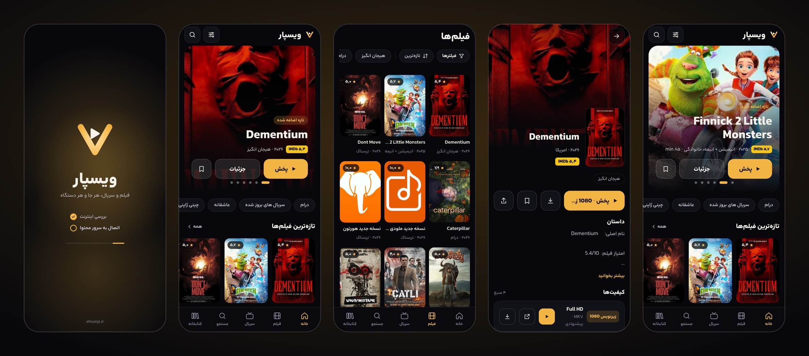
</p>

---

## Why Vispar

Vispar is a Persian-first (right-to-left) streaming client. It is built to feel native on a phone, comfortable with a TV remote, and at home in a desktop window, without maintaining three apps.

- **One codebase, seven targets.** Expo + React Native with `react-native-web`, wrapped in Electron for desktop.
- **Designed for the room it is in.** Bottom tabs on phones, a top bar on wide screens, and a labelled side rail with D-pad focus on TV.
- **Fast to start, honest when offline.** A splash that actually tests the connection instead of spinning forever.

## Highlights

| | |
| --- | --- |
| **Splash with a connection test** | The logo draws itself while two real checks run: the internet, then the content server. If either fails you get a clear page with *Retry* and *Continue offline* (your library still works). A banner appears if the connection drops later and clears itself when it returns. |
| **A real player** | Seek bar, ±10/15/30 s skip, double-tap to seek, playback speed, in-player quality switch, fit/fill/stretch, resume where you left off, autoplay next episode, background playback and picture-in-picture. |
| **External players and downloaders** | VLC, MX Player, mpv, Just Player, Kodi, KMPlayer, XPlayer, nPlayer, Infuse, Outplayer; ADM, 1DM, FDM, system download manager. Installed apps are detected on Android. On the web an `.m3u` playlist is generated. |
| **Discovery** | Home slider, continue watching, my list, top rated, genre rails, multi-filter (genre, decade, country, IMDb, quality), sorting, search and similar titles. |
| **Library** | My list, continue watching and full history, stored on the device. |
| **Personal** | System/light/dark theme, five accent colors, poster size, Persian or Latin digits, reduced motion, choose which home sections you see, default quality and player. |
| **Notifications** | Opt in to a local alert when new movies or series appear. No push server involved. |
| **Installable web app** | A PWA with offline shell. On iPhone and iPad a step-by-step *Add to Home Screen* guide appears; on Chrome and Edge the native install prompt is used. |
| **Updates from GitHub Releases** | Android and the desktop apps check [Releases](https://github.com/TssHack/vispar/releases), show the notes, and download the right installer for your platform. JS-only changes can ship over the air. |

## Screenshots

### Phone

<p align="center">
  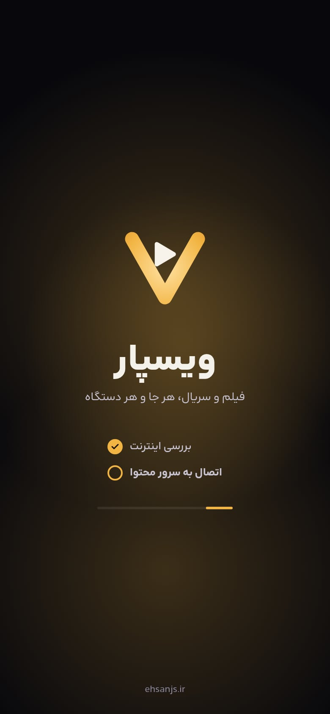
  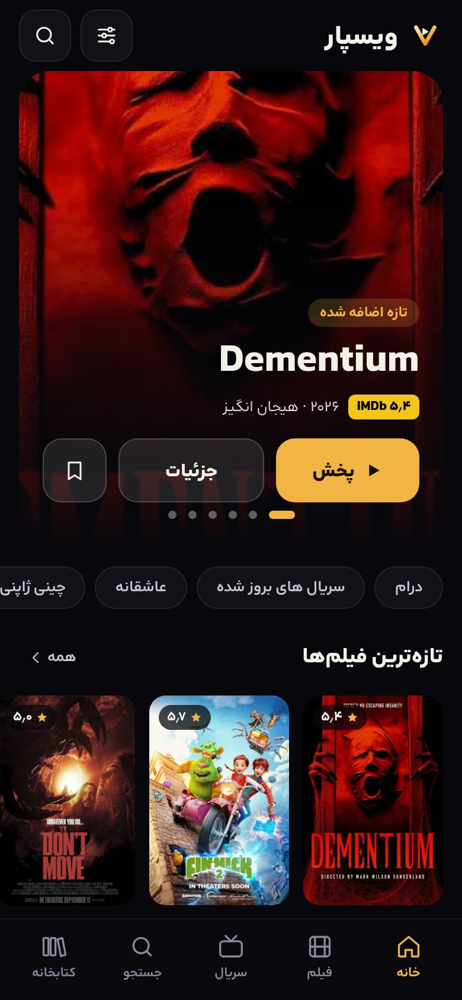
  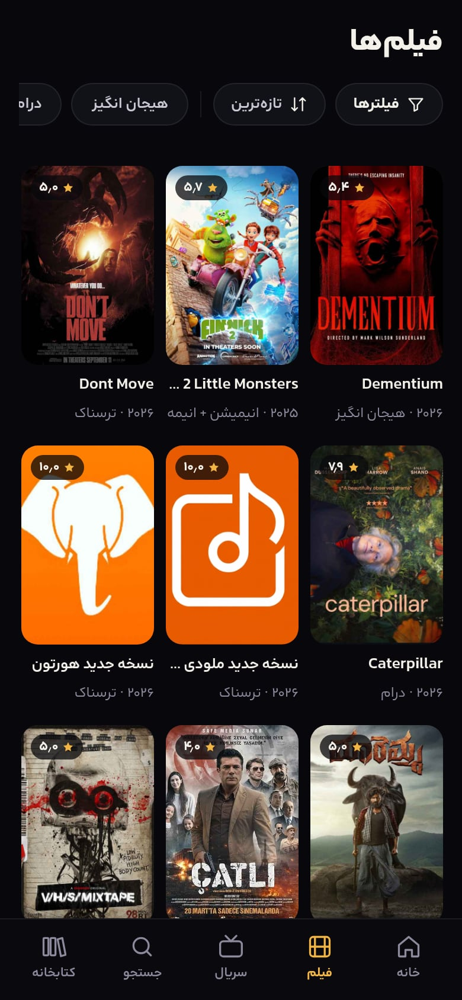
  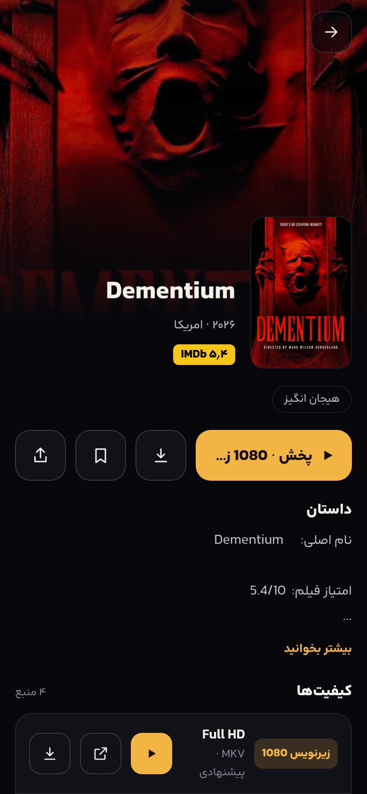
  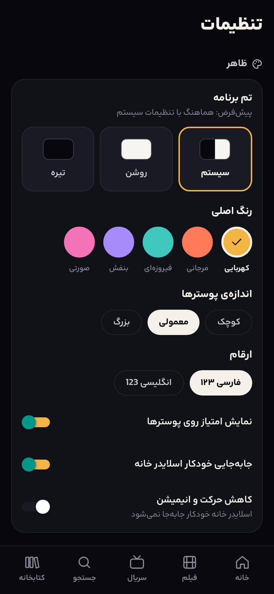
</p>

### Splash states

<p align="center">
  
  &nbsp;&nbsp;
  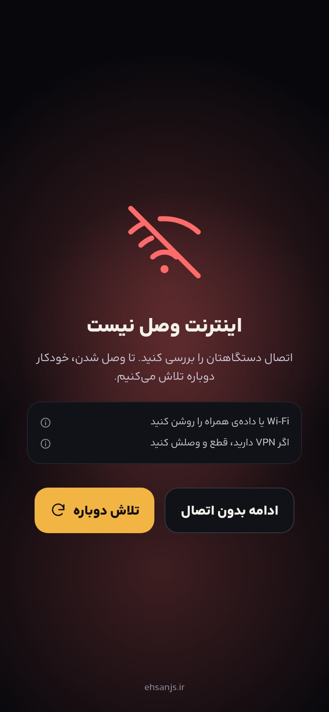
  &nbsp;&nbsp;
  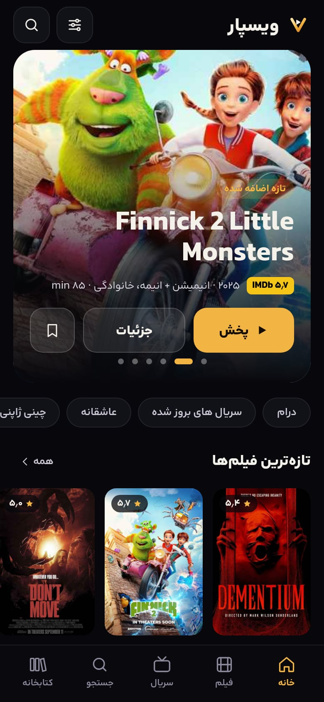
</p>

### Desktop and web

<p align="center">
  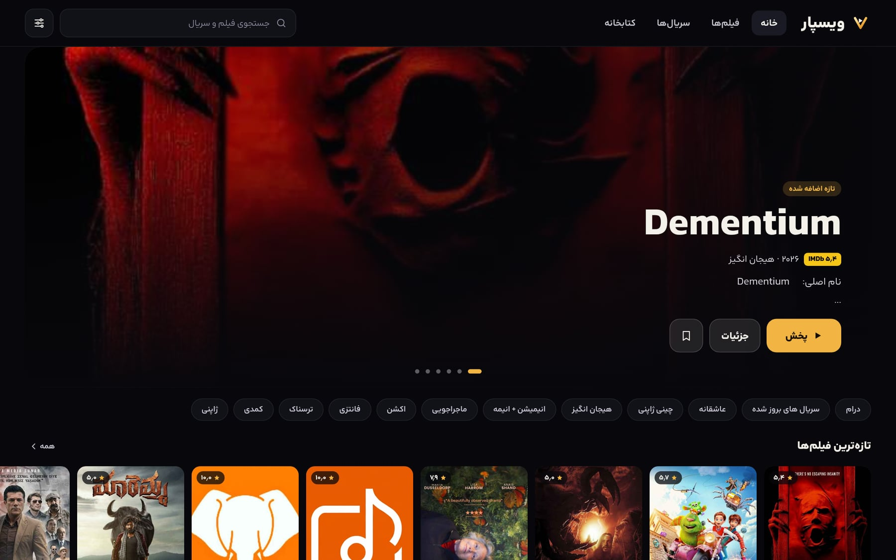
</p>
<p align="center">
  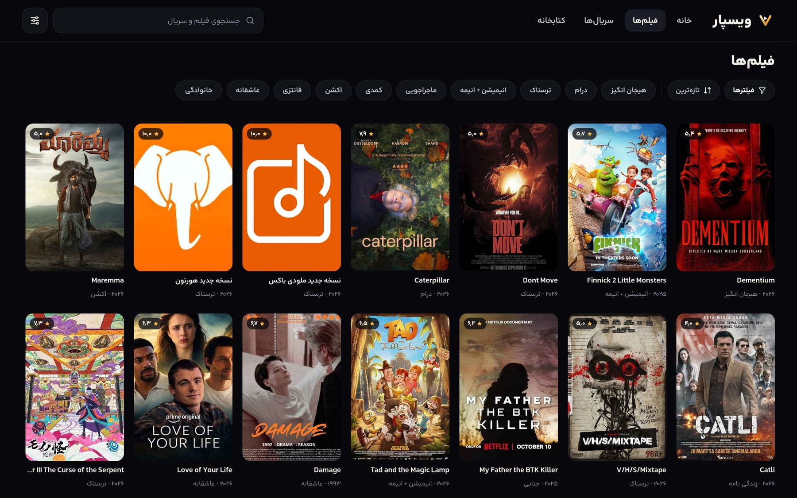
  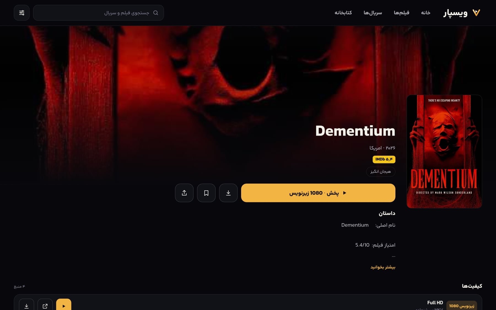
</p>
<p align="center">
  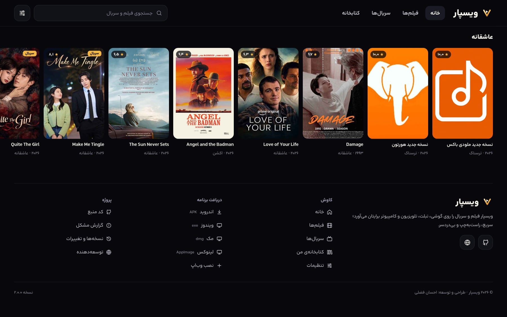
</p>

### Android TV

<p align="center">
  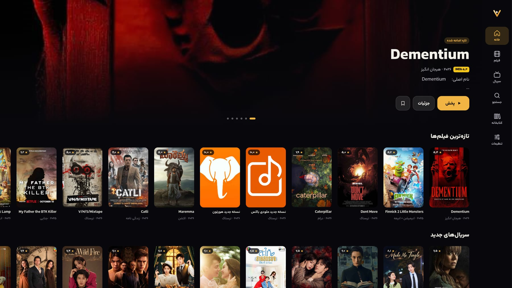
</p>

Preview the TV layout in any browser with `?tv=1`, the iOS install guide with `?ios=1`, and the splash states with `?splash=hold` or `?splash=offline`.

## Platforms

| Platform | How you get it |
| --- | --- |
| Android | APK from [Releases](https://github.com/TssHack/vispar/releases/latest), or `npm run android` |
| Android TV | Same project built with the `react-native-tvos` fork (`npm run prebuild:tv`) |
| iOS | Open the web app in Safari and follow the in-app *Add to Home Screen* guide, or build with Xcode / EAS |
| Web / PWA | `npm run build:web` and host the `dist/` folder |
| Windows | `Vispar-*-win-*.exe` (installer) or the portable build |
| macOS | `Vispar-*-mac-*.dmg` |
| Linux | `Vispar-*-linux-*.AppImage` or `.deb` |

The desktop builds are produced by the **Desktop builds** workflow (`.github/workflows/desktop.yml`). Push a `v*` tag and the installers are attached to the release automatically.

> macOS and Windows builds are not code-signed yet, so the OS will show a warning on first launch.

## TV and remote control

- Every control has a visible focus state (ring, glow and a slight lift on posters).
- A labelled side rail replaces the tab bar and remembers where you are.
- In the player the controls auto-hide. With them hidden: **← / →** seek, **OK** play or pause, **↑ / ↓** bring the controls back. Play/Pause, Rewind and Fast-forward media keys work, and **Back** closes a menu first, then the controls, then the player.
- Content is kept inside a TV-safe margin and sized for 10-foot viewing.

## Getting started

```bash
git clone https://github.com/TssHack/vispar.git
cd vispar
npm install
cp .env.example .env     # set EXPO_PUBLIC_API_BASE
npm run web              # or: npm run android
```

| Command | What it does |
| --- | --- |
| `npm run web` / `android` / `ios` | Start the dev server |
| `npm run start:tv` | Dev server in TV mode |
| `npm run typecheck` | TypeScript, strict |
| `npm test` | Unit tests (Vitest) |
| `npm run build:web` | Export the web app with PWA tags into `dist/` |
| `npm run brand:icons` / `brand:pwa` | Regenerate app and PWA icons from the logo |

### Backend

The app talks to a catalog API through a single base URL. The proxy that keeps the API key on a server and adds CORS is **not part of this repository**. Point `EXPO_PUBLIC_API_BASE` at your own proxy. Direct mode (`EXPO_PUBLIC_API_KEY`) works on native builds, but it embeds the key in the app, so avoid it for public releases.

### Desktop

```bash
npm run build:web
cd desktop && npm install && npx electron-builder
```

The Electron shell serves the exported web app from a private `app://` origin, opens external links in your browser, and supports `F11` for full screen.

### Releases and updates

1. Bump `version` in `app.json` and `desktop/package.json`.
2. Push a tag such as `v2.1.0`. CI builds Windows, macOS and Linux installers and attaches them.
3. Add an APK (`npx eas-cli build -p android --profile production`) and write the notes in the release body. That text is what users see in the update sheet.

Installed apps check at most every 12 hours, or on demand from **Settings → Check for updates**.

## Project structure

```
src/app/            screens (expo-router)
src/api/            client, tolerant parsers, react-query hooks
src/components/     UI building blocks, splash, footer, focus handling
src/net/            connection probe (internet, then API)
src/pwa/            install flow and the iOS guide
src/notifications/  local notifications and the new-content watcher
src/update/         GitHub release check, platform asset picking, OTA
src/player/         seek bar and playback context
src/external/       external players and downloaders
src/filters/        filtering and sorting
src/library/        my list, continue watching, history
src/settings/       persisted preferences
src/theme/          tokens, fonts, theme provider
desktop/            Electron shell for Windows, macOS, Linux
public/             web manifest and service worker
plugins/            Expo config plugin (installed-app detection on Android)
tests/              Vitest suites
```

## Tech

Expo SDK 58 · React Native 0.88 · expo-router · TanStack Query · expo-video · react-native-svg · Electron · Vitest · TypeScript (strict). Typeface: Arad under the SIL OFL 1.1.

## Credits

Designed and developed by **[Ehsan Fazli](https://ehsanjs.ir)**.
